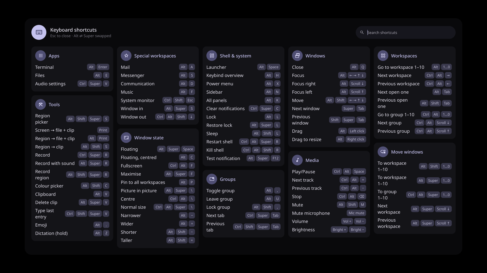
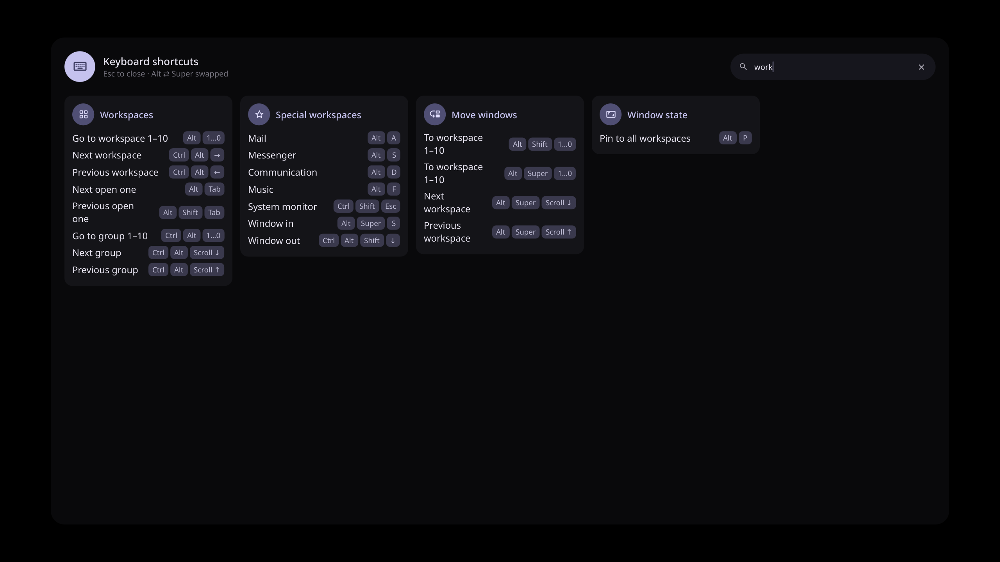

# caelestia-extras

I wanted a quick way to look up my Hyprland binds without digging through config files, so I built a cheatsheet overlay for Caelestia shell. A few small fixes for my two-monitor setup ended up here too. Everything is a patch you can install and remove on its own.



Small add-ons for [Caelestia shell](https://github.com/caelestia-dots/shell), installed as patches.

| Feature | What it does |
|---|---|
| `cheatsheet` | Searchable overview of all key binds, read live from Hyprland. Fits on one screen, shows the real key names when Alt and Super are swapped, leaves the bar free. |
| `bar-focused-workspace` | With `bar.workspaces.perMonitor` off, the bar highlights the workspace you are actually on, also when it is on another monitor. |
| `bar-leftmost-only` | The bar only appears on the leftmost screen, whatever its name. |
| `lock-leftmost-only` | The lock screen shows clock and password field only on the leftmost screen. |

Tested with caelestia-shell 2.5.0 (AUR) on Hyprland 0.56 with two monitors.

## Install

```sh
git clone https://github.com/romanvesely/caelestia-extras
cd caelestia-extras
./install.sh --list
sudo ./install.sh --hook cheatsheet bar-focused-workspace
caelestia shell -r
```

`install.sh` installs exactly the features you name; run it again with a different list to change them.
Before touching anything it tries every patch on a copy of the shell, so a feature that does not fit your shell version changes nothing.

`--hook` adds a pacman hook that applies the features again after every caelestia-shell upgrade.
Without it, run `sudo ./install.sh ...` again after an upgrade.

## Cheatsheet setup

The Caelestia Hyprland config is written in Lua, and Lua binds carry no description, so the cheatsheet needs labels and a key to open it:

```sh
cp hypr/extras-cheatsheet.lua ~/.config/caelestia/
echo 'require("extras-cheatsheet").setup()' >> ~/.config/caelestia/hypr-user.lua
```

That binds `Super + H` and labels all default Caelestia binds.
A different key and labels for your own binds go into `setup()`, see the top of [`hypr/extras-cheatsheet.lua`](hypr/extras-cheatsheet.lua).
Binds without a label are listed under "Unlabelled".
Binds with a description (hyprlang `bindd`) are labelled without the file.

Type to search descriptions, categories and key names:



The cheatsheet can also be opened with `caelestia shell cheatsheet toggle`.

## Uninstall

```sh
sudo ./install.sh --uninstall
caelestia shell -r
```

Remove the `require("extras-cheatsheet")` line from `hypr-user.lua` if you added it.

## Notes

- Tested on my own setup. As-is, best effort.
- Caelestia changes fast; if a feature stops applying after an update, please open an issue with your caelestia-shell version.
- Licence: GPL-3.0, like Caelestia shell.
